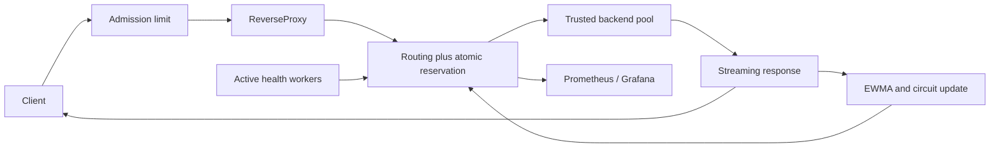
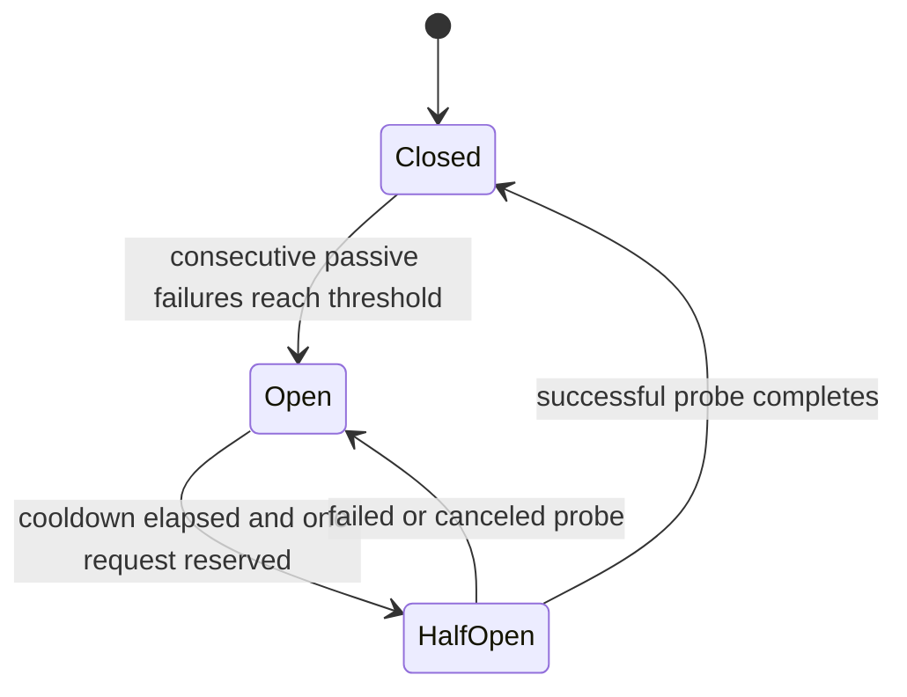

# Design and invariants

## Request path



A single short pool mutex protects backend state and policy state. Selection and active-request increment happen in the same critical section. Network I/O, body copying, health requests, and metrics writes happen outside it. This avoids the classic least-connections race where many simultaneous requests observe and choose the same idle server.

A lease owns one active count. Its `sync.Once` completion releases exactly once on EOF, body read error, Close, or a failed transport attempt. Client cancellation releases capacity without marking the backend failed. A request can have multiple sequential leases if a safe retry occurs; the global admission slot covers the entire downstream request.

Full-body service time is the EWMA observation. This intentionally accounts for streams holding capacity, but means latency estimates mix heterogeneous request sizes and classes. Metrics are backend-level, not URL-level. A production extension could use a bounded set of operator-defined workload classes or separate time-to-first-byte/service-time estimators.

## Routing interface

`Router.Choose(candidates, now)` returns a stable backend index, or -1. The pool supplies only healthy, unsaturated candidates with an eligible circuit, excluding already-tried backends. Policies are deterministic for a fixed sequence of snapshots and timestamps. The policy itself is not independently concurrent; the pool serializes it.

- **Round robin:** rotates across eligible candidates. Equal distribution holds for a stable eligible set. Capacity/health changes naturally change that set.
- **Least connections:** chooses the fewest active requests, rotating exact ties. Active means in-flight HTTP requests, not TCP socket count.
- **Weighted round robin:** smooth weighted round robin with per-backend current weight. Removed candidates lose scheduling debt. Over a stable set, 1:2:3 weights produce exactly 100:200:300 selections in 600 requests.
- **Adaptive:** minimizes a dimensionless weighted score, with periodic oldest-selected exploration and a configurable preference hysteresis.

## Adaptive score

Let `L` be the full-body latency EWMA in seconds, `E` the failure EWMA, `A` active requests, `C` concurrency capacity, `W` capacity weight, and `L0` the latency reference. For each eligible backend:

```text
f = exp(-observation_age / stale_after)
L_effective = L0 + (L - L0) * f
E_effective = E * f

latency  = L_effective / L0
active   = A / C
error    = E_effective
pressure = (A + 1) / (C * W)

score = alpha*latency + beta*active + gamma*error + delta*pressure
```

The configured keys `latency`, `active`, `error`, and `pressure` are alpha, beta, gamma, and delta. Default coefficients are 1, 1, 4, 1. Lower scores are preferable. Capacity and weight are strictly positive. Latency and pressure are ratios, not bounded percentages; latency can exceed 1. New backends start with the neutral prior `L0` and zero observed error. Sample updates use `smoothing*new + (1-smoothing)*old`.

Every `explore_every` selections (default 20), the oldest-selected eligible backend gets a request. That prevents a slow but available server from being permanently ignored and measures recovering performance. There is no exploration guarantee for unhealthy, saturated, or open-circuit backends before cooldown.

On ordinary selections, the previously chosen eligible backend is retained if its current score is within `(1+hysteresis)` of the minimum. This and EWMA damping reduce small-score oscillations. Exploration takes priority over hysteresis. Neither implies that the heuristic is optimal; compare workload-specific error/latency tradeoffs experimentally.

The implementation uses an O(n) scan, capped at 1,024 configured backends. Power-of-two choices was considered but not selected: full scans make exploration and score comparisons transparent and deterministic for the intended small pool. The shared lock and scans are known scalability limits. Profile `BenchmarkPoolReservation` under realistic concurrency before replacing this with sharded state or sampled selection. Routing-only benchmarks exclude reservation and networking cost.

## Health and circuit state

Backends start unhealthy. A dedicated serial worker per backend runs an immediate check, then waits `health_interval` after each check completes. There is no overlap for the same backend. Checks have a separate timeout, do not follow redirects, and use no ambient HTTP proxy. Responses must be 2xx. Failure and success streak thresholds control the active-health flag independently of the passive circuit.



Only an actively healthy backend is eligible for a recovery probe. An open circuit stays marked open until a request reserves the half-open probe after cooldown; time alone does not close it. Active health success does not override an open circuit. Readiness becomes true when an actively healthy circuit can accept a recovery probe after cooldown (and stays true while that probe is in progress), so an orchestrator withholding traffic cannot prevent recovery forever. Half-open allows only one new probe, but older requests that started before the circuit opened may still be finishing. Recovery success means a completed response, not just accepted headers.

Circuit generations prevent a late success from an older in-flight request closing a newly opened circuit. Stale completions still contribute observations and error counts, but cannot transition the newer circuit. Consecutive failures are measured in completion order.

By default, transport errors and 500/502/503/504 statuses count as passive failures. 4xx statuses do not. Configured failure statuses must be 5xx. A backend can be actively healthy but circuit-open, or actively unhealthy but circuit-closed; the dashboard exposes both.

## Retry semantics

Explicit retries are sequential, bounded to at most three selections and one header-acquisition time budget, and never revisit the same backend within a request. Each attempt respects cancellation and configured transport timeouts. No sleep/backoff is inserted into the latency-sensitive retry path: the low attempt cap, global concurrency limit, per-backend capacity, and circuit breakers bound amplification. Retries can still amplify load and should be disabled (`max_attempts=1`) when that is unacceptable.

GET, HEAD, OPTIONS, PUT, and DELETE are eligible only with no body or a `GetBody` replay function. Incoming network requests normally have no `GetBody`, so uploads are not buffered for retries and body-bearing requests are normally attempted once. POST and PATCH are never explicitly retried. Idempotency headers are preserved but do not change the application retry policy. The Go transport's own safe stale-connection recovery is a separate mechanism.

Transport failures and configured 502/503/504 responses can cause retries. Other application statuses are passed through. A failed attempt's response body is closed without unbounded draining. Once final response headers leave the retry transport, no application retry is possible, even if a body later fails. A midstream failure aborts the downstream response; no second HTTP status can be written safely.

Non-replayable uploads have no retry timer; the per-attempt header timeout starts after upload, and the client context governs the body. The shared retry budget timer for replayable requests is stopped when final headers arrive so it cannot routinely terminate a valid long stream. The downstream context remains attached for cancellation. There is no total response-body deadline. If all retry candidates are exhausted after a failure, the proxy returns 502; if none was initially eligible, it returns 503. Local admission saturation also returns 503.

## HTTP and security decisions

Use `httputil.ReverseProxy.Rewrite` to avoid trusting inbound forwarding identity. Remove all supplied X-Forwarded-* fields, Forwarded, and X-Real-IP before setting connection-derived X-Forwarded-For/Host/Proto. Ordinary headers, methods, body streams, query parameters, and destination base paths are preserved. Upstream Host is the configured backend host. The standard library handles hop-by-hop headers and HTTP framing; tests include conflicting Content-Length fields.

A trusted configuration URL is selected for every attempt; neither Host nor a query/body value chooses a target. Absolute-form requests, CONNECT, and upgrades are rejected. The default transport does not honor HTTP_PROXY environment variables. HTTPS backends use standard certificate verification. Destination DNS changes are trusted infrastructure changes, not an SSRF allowlist feature.

No special client IP is treated as trusted, no TLS/authentication edge is implemented, and no unbounded request buffering is used. Header-size/read-header, dial, handshake, response-header, idle-connection, admission, and shutdown limits are set. Do not infer protection from every form of slow-body or stream resource abuse; deploy suitable edge limits.

## Observability and shutdown

Backend IDs and the fixed algorithm/component names are the only metric labels. There are no raw-path, client, or request-ID labels. Request latency includes selection, retry, and downstream response copying. Backend request counters count attempts; client request counters count completed downstream handler executions. Failed-request counters include local rejections and aborted streams; backend errors omit client cancellations.

Histograms expose cumulative buckets, +Inf, count, and sum. Heap allocation is Go heap, not process RSS. Process CPU seconds are available on Linux/macOS; the portable fallback omits CPU rather than fabricating it. Active health availability, circuit state, score components, and transitions are distinct series. Scores for unavailable backends are diagnostic only; they do not imply routing eligibility.

SIGINT/SIGTERM stops accepting data requests and drains handlers up to `shutdown_timeout`, then force-closes remaining connections. Health checks remain active during draining and stop afterward. The admin listener is shut down and idle upstream connections are closed. There is no automatic persistent state across restarts.

## Standard-library references

The proxy follows the documented contracts for [ReverseProxy / Rewrite](https://pkg.go.dev/net/http/httputil#ReverseProxy), [ProxyRequest.SetXForwarded](https://pkg.go.dev/net/http/httputil#ProxyRequest.SetXForwarded), and [HTTP Transport](https://pkg.go.dev/net/http#Transport). Transport response-header timeout excludes body reading; stale pooled-connection recovery is internal to the standard library.
